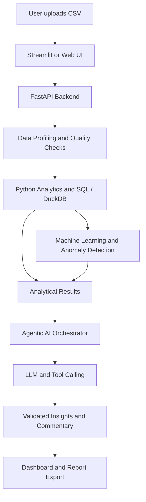

# Machine learning with agentic AI

# Machine Learning with Agentic AI

**Building an end-to-end AI-powered data analysis platform using machine learning, large language models, and agentic AI.**

[](https://www.python.org/)
[](https://scikit-learn.org/)
[]()
[](https://docs.pytest.org/)
[]()

## Overview

Machine Learning with Agentic AI is an end-to-end project focused on building an intelligent data analysis platform that combines traditional data science, machine learning, and agentic AI.

The platform aims to help users turn raw datasets into actionable insights with minimal manual effort. Users will be able to upload structured data, assess data quality, explore trends, detect anomalies, ask questions in natural language, and generate reports supported by data-driven analysis.

Rather than relying entirely on an LLM to interpret data, the platform will combine deterministic Python-based analytics, machine learning models, SQL-based data querying, and AI agents that can select and execute appropriate analytical tools.

The project also serves as a practical learning and engineering portfolio, demonstrating how to develop, test, package, deploy, and monitor an AI-powered application using production-oriented software engineering practices.

**Project objective:** Build a reliable, explainable, and extensible AI data analyst that bridges the gap between raw data and business decision-making.

## Problem statement

Analysing business and operational data often involves several manual steps:

- Inspecting datasets and understanding their structure.
- Identifying missing values, duplicates, invalid records, and inconsistencies.
- Calculating key performance indicators (KPIs) and summarising trends.
- Investigating anomalies and unexpected changes.
- Creating visualisations and explaining findings to non-technical stakeholders.
- Producing reports that can support evidence-based decisions.

These tasks can be time-consuming, especially for users who do not have advanced programming or analytical skills.

This project explores how machine learning and agentic AI can automate parts of this workflow while maintaining analytical accuracy, transparency, and human oversight.

## Key features

The following features represent the intended project scope. They will be implemented and validated incrementally.

### 1. Data ingestion and profiling

- Upload structured datasets in CSV format.
- Inspect column names, data types, dimensions, and sample records.
- Generate descriptive statistics and data summaries.
- Identify missing values, duplicate records, and potential data-quality issues.
- Produce a structured data profiling report.

### 2. Automated data quality assessment

Assess datasets against six core data quality dimensions:

| Dimension | Purpose |
|---|---|
| Accuracy | Assess whether values correctly represent the underlying real-world information, where a trusted reference is available. |
| Completeness | Identify missing values and incomplete required fields. |
| Consistency | Detect conflicting values, formats, and relationships. |
| Timeliness | Assess data freshness against expected update requirements. |
| Validity | Check whether values conform to defined formats, types, ranges, and business rules. |
| Uniqueness | Identify duplicate records and violations of expected uniqueness constraints. |

The system will distinguish between issues that can be detected directly from the dataset and those that require external reference data or business rules.

### 3. Automated exploratory data analysis

- Generate summary statistics for numerical and categorical variables.
- Explore distributions and relationships between variables.
- Calculate configurable business KPIs.
- Identify trends and potential correlations.
- Generate appropriate charts and visual summaries.
- Produce concise, evidence-based analytical observations.

### 4. Machine learning and anomaly detection

- Apply suitable machine learning techniques to supported datasets.
- Detect unusual observations and potential anomalies.
- Evaluate model performance using appropriate metrics.
- Track experiments and compare model configurations.
- Record model assumptions, limitations, and evaluation results.

Model selection will depend on the dataset, analytical objective, and availability of labelled data.

### 5. Natural-language data analysis

Allow users to ask questions about their datasets using ordinary language.

Example questions:

- What are the main trends in this dataset?
- Which products or customer segments contribute the most revenue?
- Have there been any unusual changes in performance?
- Which variables appear to be associated with customer churn?
- Summarise the main findings for a business stakeholder.

The application will translate supported questions into structured analytical operations, execute the relevant calculations, and return answers grounded in the resulting data.

### 6. Agentic AI and tool use

The agentic AI layer will coordinate analytical tasks rather than simply generate text in response to prompts.

Planned capabilities include:

- Selecting appropriate analytical tools based on the user's question.
- Calling Python analytics and SQL-query tools.
- Combining profiling, statistical analysis, and machine learning results.
- Using structured outputs to make responses predictable.
- Applying validation and guardrails to tool inputs and outputs.
- Providing traceable evidence for generated insights.
- Requesting clarification or human review when a task is ambiguous or cannot be completed reliably.

The agent will operate within defined permissions and resource limits. It will not be given unrestricted access to execute arbitrary code or modify user data.

### 7. AI-generated reports and visualisations

- Generate charts, KPI summaries, and analytical findings.
- Produce management-friendly commentary.
- Summarise important trends, anomalies, and data-quality concerns.
- Export supported outputs and reports for further use.
- Make the distinction between observed results, model predictions, and AI-generated interpretations clear.

## System architecture

The proposed architecture separates the user interface, analytical services, machine learning components, and AI orchestration layer.



The LLM will interpret user intent, coordinate supported tools, and communicate findings. Numerical calculations, data-quality checks, and model evaluation will be performed by dedicated analytical components wherever possible.

This separation is intended to reduce unsupported claims and make the system easier to test and maintain.

## Technology stack

The stack will evolve as the project develops.

| Area | Planned technologies |
|---|---|
| Programming language | Python |
| Data processing | pandas, NumPy |
| Machine learning | scikit-learn |
| Data querying | SQL, DuckDB |
| AI and LLM integration | LLM APIs, structured outputs, function/tool calling |
| Retrieval and context | Embeddings, RAG, vector database where justified |
| Backend API | FastAPI |
| User interface | Streamlit initially |
| Experiment tracking | MLflow |
| Testing | pytest |
| Code quality | Ruff, formatting, pre-commit |
| Containerisation | Docker, Docker Compose |
| CI/CD | GitHub Actions |
| Cloud deployment | Azure or Google Cloud, depending on the deployment stage |
| Version control | Git and GitHub |

Technologies will be introduced when they solve a specific problem rather than added simply to increase the number of tools in the stack.

## Repository structure

The repository will be organised to separate application code, analytical logic, testing, and deployment configuration.

```text
machine-learning-with-agentic-ai/
├── data/
│   ├── raw/
│   └── processed/
├── notebooks/
│   └── exploratory_analysis.ipynb
├── src/
│   └── agentic_data_analyst/
│       ├── __init__.py
│       ├── ingestion/
│       ├── profiling/
│       ├── quality/
│       ├── analytics/
│       ├── models/
│       ├── agents/
│       ├── tools/
│       ├── api/
│       └── reporting/
├── app/
│   └── streamlit_app.py
├── tests/
│   ├── unit/
│   ├── integration/
│   └── evaluation/
├── configs/
├── docs/
├── scripts/
├── .github/
│   └── workflows/
├── .pre-commit-config.yaml
├── .gitignore
├── Dockerfile
├── docker-compose.yml
├── environment.yml
├── requirements.txt
├── setup.py
└── README.md
```

*Note: This is the proposed target structure. Directories and files will be added as the corresponding components are implemented.*

## Getting started

### Prerequisites

- Python 3.11, or the version specified by the project configuration.
- Git.
- Conda or a compatible Python environment manager.
- An LLM API key for features that require an external model provider.
- Docker, when running the containerised application.

### 1. Clone the repository

```bash
git clone <your-repository-url>
cd machine-learning-with-agentic-ai
```

Replace the placeholder with the URL of your repository.

### 2. Create the development environment

If using Conda:

```bash
conda env create -f environment.yml
conda activate <your-environment-name>
```

Alternatively, create a virtual environment:

```bash
python -m venv .venv
```

Activate it on Windows:

```bash
.venv\Scripts\activate
```

Or on macOS/Linux:

```bash
source .venv/bin/activate
```

Install the project dependencies:

```bash
pip install -r requirements.txt
```

### 3. Configure environment variables

Create a local `.env` file if required by the selected application configuration.

```dotenv
LLM_PROVIDER=<your-provider>
LLM_API_KEY=<your-api-key>
```

Use the variable names expected by the implementation. The example above is illustrative, not a guarantee that these variables are already supported.

Never commit API keys, passwords, credentials, or other secrets to version control.

### 4. Run the application

Once the relevant application components have been implemented, the intended local entry point will be:

```bash
streamlit run app/streamlit_app.py
```

The API service, when available, can be started with:

```bash
uvicorn agentic_data_analyst.api.main:app --reload
```

These commands describe the planned entry points and may need adjustment to match the actual files as the project develops.

## Development workflow

The project will follow an incremental development process.

1. **Understand the problem:** Define the user needs, supported data formats, analytical requirements, and success criteria.
2. **Build the analytical foundation:** Implement data ingestion, profiling, quality checks, and deterministic analysis.
3. **Add machine learning:** Introduce appropriate models and establish baseline evaluation metrics.
4. **Integrate LLM capabilities:** Add natural-language questions, structured outputs, and controlled tool calling.
5. **Introduce agentic workflows:** Enable the agent to plan and coordinate supported analytical operations.
6. **Engineer for production:** Add testing, logging, configuration management, Docker, and CI/CD.
7. **Deploy and evaluate:** Deploy the application, assess its performance, and improve it based on evaluation results.

Development will use small, focused Git branches and pull requests, with automated checks and code review where appropriate.

## Testing and evaluation

Reliability is a core design principle. The platform will be tested at both the software and analytical levels.

### Software testing

- Unit tests for individual functions and components.
- Integration tests for data processing and API workflows.
- Input validation and error-handling tests.
- Tests for edge cases, empty datasets, missing values, and unexpected data types.
- Automated linting and test execution in the CI pipeline.

### Machine learning evaluation

- Establish baseline models before introducing more complex approaches.
- Select metrics appropriate to the task.
- Compare experiments using MLflow where applicable.
- Test model behaviour on held-out data.
- Document limitations, assumptions, and potential sources of bias.

### Agentic AI evaluation

- Measure the correctness of tool selection and execution.
- Check whether answers are supported by actual analytical results.
- Test ambiguous questions, invalid inputs, and failure scenarios.
- Evaluate consistency, structured-output validity, and error recovery.
- Monitor latency and model usage costs.

Performance figures and evaluation results will be documented after experiments have been run. No accuracy, speed, or business-impact claims will be made without supporting evidence.

## Data and security considerations

The project will prioritise responsible handling of user-provided datasets.

- Use public or synthetic datasets during development.
- Avoid committing raw datasets containing personal, confidential, or sensitive information.
- Validate uploaded files and enforce reasonable file-size and processing limits.
- Keep credentials in environment variables or a dedicated secrets manager.
- Apply access controls and logging appropriate to the deployment environment.
- Avoid sending sensitive data to external LLM providers without appropriate authorisation and safeguards.
- Treat data and retrieved documents as untrusted inputs.
- Restrict agent tools to explicitly permitted operations.
- Document data retention, deletion, and privacy requirements before production use.

## Current status

**Status: In development.**

The repository is intended to evolve from a Python project template into a working AI-powered data analysis platform.

| Milestone | Deliverable |
|---|---|
| 1. Project foundation | Repository structure, environment configuration, code quality checks, and initial tests |
| 2. Data analysis foundation | CSV ingestion, profiling, six-dimension data quality assessment, and exploratory analysis |
| 3. Machine learning | Baseline models, anomaly detection, evaluation, and experiment tracking |
| 4. Agentic AI | LLM integration, analytical tools, natural-language questions, and controlled tool orchestration |
| 5. User experience | Interactive dashboard, visualisations, and downloadable reports |
| 6. Production engineering | Docker, API integration, automated testing, and CI/CD |
| 7. Deployment and monitoring | Cloud deployment, logging, evaluation, and operational improvements |

Milestones will be marked complete as their implementations and tests are verified.

## Future improvements

Potential extensions include:

- Support for Excel files, databases, and additional data sources.
- More advanced forecasting and predictive modelling.
- Retrieval-augmented generation for domain-specific analytical context.
- Multi-step agent workflows with explicit planning and validation.
- Model and agent evaluation dashboards.
- Improved observability, caching, and cost controls.
- Authentication, role-based access, and secure multi-user support.
- Deployment automation and ongoing performance monitoring.

## Learning objectives

This project provides practical experience in:

- End-to-end machine learning development.
- Data engineering and data quality assurance.
- LLM integration and agentic AI design.
- Tool calling, structured outputs, and retrieval-augmented generation.
- API development and modular Python architecture.
- Unit, integration, and AI-specific evaluation.
- Experiment tracking and model lifecycle management.
- Docker, CI/CD, and cloud deployment.
- Building reliable AI applications with appropriate security and monitoring.

## Contributing

Contributions and suggestions are welcome as the project develops.

For proposed changes:

1. Create a focused feature branch.
2. Keep changes modular and documented.
3. Add or update tests.
4. Run the relevant quality checks.
5. Open a pull request describing the change and its expected behaviour.

## License

The project licence has not yet been specified. Add a `LICENSE` file before distributing or reusing the repository under an explicit open-source licence.

---

**Project vision:** Make data analysis more accessible by combining reliable analytical methods with AI systems that can reason about a task, use appropriate tools, and communicate evidence-based findings.


